# The Applied Edge Ai Development Accelerator Program with VSDSquadron Pro
<details> 
<summary>
About
</summary>  

---

# RISC-V EdgeAI Workshop (by VSD) — Summary

## 🎯 What is it?

The RISC-V EdgeAI Workshop is a **10-day hands-on program** focused on building and deploying neural networks and classical ML models on a **RISC-V microcontroller** (specifically the board VSDSquadron Pro) — targeting **edge / embedded AI** under strong memory constraints (16 KB RAM). ([VLSI System Design][1])

Key goals:

* Train models in Python (e.g. with Scikit-learn) or other ML tools. ([VLSI System Design][1])
* Quantize & optimize those models (e.g. 8-bit quantization, pruning) for deployment on resource-constrained RISC-V MCU. ([VLSI System Design][1])
* Deploy and run inference (e.g. digit-recognition on MNIST) on the RISC-V board — with real-time performance, memory profiling, and benchmarking. ([VLSI System Design][1])
* Gain experience with the full pipeline: *train → quantize → deploy → benchmark → memory optimization*. ([VLSI System Design][1])
* Build a deployable TinyML portfolio — quantized models, deployment scripts, memory/latency reports. ([VLSI System Design][1])

---

## 🧠 Curriculum

* **ML Foundations**: Linear regression, gradient descent, training from scratch. ([VLSI System Design][1])
* **Classical ML**: K-Nearest Neighbors (KNN), Support Vector Machines (SVM), classification tasks, decision boundary visualization. ([VLSI System Design][1])
* **Quantization & Memory Optimization**: 8-bit quantization, weight pruning, model size reduction (e.g. compressing models down to 16 KB RAM footprint) while measuring accuracy vs memory tradeoff. ([VLSI System Design][1])
* **Neural Networks on RISC-V**: Build simple MLPs or small neural nets, optimize for memory & latency, deploy on VSDSquadron Pro. ([VLSI System Design][1])
* **Real-time Inference & Benchmarking**: Deploy on-device (e.g. MNIST digit recognition), measure inference latency, memory usage, stability, variations under resource constraints. ([VLSI System Design][1])
* **End-to-End Deployment Workflow**: From Python-based model training, through quantization/compression, to embedded C/firmware deployment, with reproducible scripts and deployment templates. ([VLSI System Design][1])

---

## ✅ What makes this Workshop Unique / Useful

* Real-world **edge-AI constraints**: Everything is optimized for **16 KB RAM** — realistic for microcontrollers/embedded devices. ([VLSI System Design][1])
* Works with **open-source toolchains** — no reliance on proprietary hardware or closed ecosystems. ([VLSI System Design][1])
* Provides **ready-to-deploy templates and scripts** (for quantization, conversion, deployment, memory profiling) — lowers barrier to embed ML on RISC-V MCU. ([VLSI System Design][1])
* Produces a **portfolio** suitable for embedded/IoT / TinyML jobs: quantized models, memory-optimized deployments, benchmark reports. ([VLSI System Design][1])
* Demonstrates feasibility of running ML/AI even in **very resource-limited environments** (as low as 16 KB RAM) — showing how edge-AI does not always need powerful hardware. ([VLSI System Design][1])


---

## 🛠️ Technologies / Tools Used in Workshop

* Python + Scikit-learn (for classical ML) ([VLSI System Design][1])
* Quantization, pruning & model compression tools / scripts (custom or open-source) for reducing model size. ([VLSI System Design][1])
* RISC-V board: VSDSquadron Pro (SiFive-based), using open-source RISC-V toolchains. ([VLSI System Design][1])
* Memory profiling & latency benchmarking tools to ensure deployment fits under 16 KB RAM. ([VLSI System Design][1])
* Deployment templates from Python → C / firmware to run inference on embedded hardware. ([VLSI System Design][1])

---

</details>

  
## 1. AI vs Classic Logic   

### Traditional Logic  
We define the rules to be followed for the execution of the program. Code is predicatable as we have created the rules and algorithms. Supported by diverse programming languages. For low level-programming we know that we use Assembly Language.  
  
### AI  
Consider it as a toddler learning patterns and applying it by hit and trial, on the basis of the teaching we have gave it.   
eg. A riscv c code is ran and gives output, is a traditional system. Now, for AI based logic, we give it certain info like cat and dog and when tasked to recognize, the model needs to have the answer.  
  
Challenges:  
- Internet Required  
- Low RAM and power.
- Full control.  
  
  
 <details>
<summary>About the VSD Squadron mini and Pro Boards</summary>  
  
| Feature          | VSDSquadron Mini                         | VSDSquadron Pro                              |
|------------------|-------------------------------------------|-----------------------------------------------|
| **SoC / Chip**   | CH32V003F4U6 (RV32EC ISA)                 | SiFive FE310-G002 (RV32IMAC ISA)              |
| **Clock Speed**  | 24 MHz                                    | 320 MHz                                       |
| **SRAM**         | 2 KB                                      | 16 KB Data + 16 KB Instruction Cache          |
| **Flash Memory** | 16 KB (Internal)                          | 32 Mbit / 4 MB (External Flash Chip)          |
| **Digital I/O**  | 15 GPIO Pins                              | 19 GPIO Pins                                  |
| **PWM Pins**     | Not specified in summary (available)      | 9 PWM-capable Pins                            |
| **IDE / Software** | PlatformIO (VSCode)                     | Freedom Studio (RISC-V GCC Toolchain)         |
| **Dimensions**   | 50.00 × 28.00 mm                          | 84.00 × 52.00 mm                              |  
| **Board Photo**  | 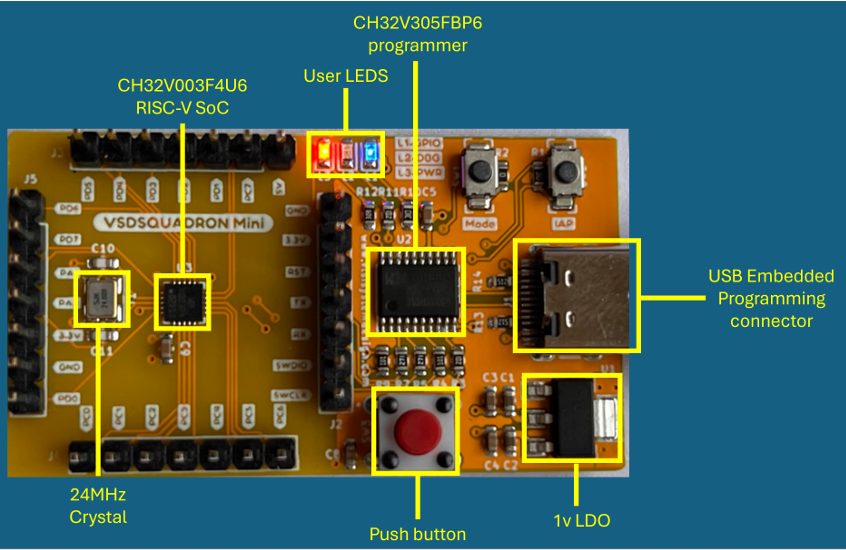                                          |  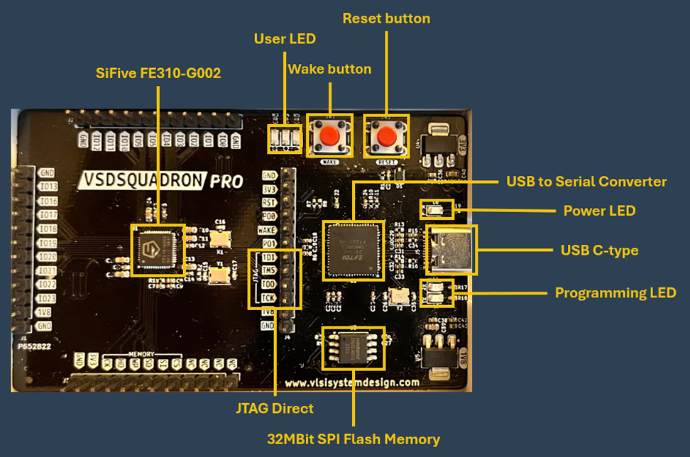                         |


</details>   

----   

# VSD-Edge-AI-Lab Modules   

<details>
<summary>     
Tools Used  </summary>  

### Furthermore for this workshop we have used the following tools:   

- **Freedom Studio**    


   


Freedom Studio = SiFive’s official Eclipse-based IDE for RISC-V programming and debugging. It is tool used for our project, an Integrated Development Environment (IDE) provided by SiFive for developing software on RISC-V–based processors.    
✅ What Freedom Studio Includes

- A customized Eclipse-based IDE
- GNU GCC toolchain for RISC-V
- OpenOCD for debugging
- SDKs for SiFive Freedom platforms
- Also, Support for writing, building, and debugging C/C++ applications on RISC-V cores

✅ Where It Is Used

 <li>RISC-V learning and experimentation
 Edge AI or embedded system development (if using RISC-V boards)
 Programming SiFive boards such as HiFive1, HiFive Unleashed, etc.
</li>

---


## 1. **Google Colab**

**Google Colab (Colaboratory)** is a cloud-based Python development environment provided by Google that allows users to write and execute Python code directly in the browser.

### Key Features

* No installation required
* Free access to **GPU and TPU**
* Supports popular ML libraries like:

  * TensorFlow
  * PyTorch
  * NumPy
  * Matplotlib
* Easy sharing of notebooks like Google Docs

### Uses in AI/ML

* Training machine learning models without local hardware
* Running deep learning experiments
* Data visualization
* Collaborative coding for projects and research

### Advantages

* Fast setup and execution
* Works on low-end devices
* Auto-saves to Google Drive

---

## 2. **MNIST Dataset Resource (UCSD Page)**

Source: [https://www.ccom.ucsd.edu/~cdeotte/programs/MNIST.html](https://www.ccom.ucsd.edu/~cdeotte/programs/MNIST.html)

This webpage provides a **simple and educational explanation** of the **MNIST handwritten digit dataset** and how it can be used in machine learning.

### What MNIST Is

MNIST is a dataset of:

* 70,000 grayscale images of handwritten digits (0–9)
* Image size: **28 × 28 pixels**

### What This Page Provides

* Python code examples to:

  * Load the MNIST dataset
  * Visualize digits
  * Train simple classifiers
* Step-by-step explanation of:

  * Neural networks
  * Training logic
  * Model evaluation

### Why It’s Useful

* Beginner-friendly learning resource
* Helps understand **image classification**
* Often used as the first dataset for deep learning projects

---

## 3. **Desmos**

**Desmos** is an online **graphing calculator** that allows users to visualize mathematical equations and functions interactively.

### Key Features

* Real-time graph plotting
* Sliders to change parameters dynamically
* Supports:

  * Linear equations
  * Quadratic functions
  * Trigonometric functions
  * Inequalities

### Uses in AI and ML

* Visualizing:

  * Linear regression lines
  * Decision boundaries
  * Cost functions
  * Gradient descent behavior

### Advantages

* No installation required
* Easy, visual, and interactive
* Perfect for understanding math concepts behind ML

---


</details>  

##  Execution of the Program Flow  
<details> <summary>   
  Initial Setup
  
</summary>  

1. Setting Up the Environment.

We used GitHub codespace for cloud based lab. The steps are simple as follows:

    1.Open the git hub link provided by vsd: 
    
    2.Click on green code button and find out the create codespace on main option.
    3.Wait for a few seconds and VSCode like tab will open.
    4. Now find the Internet symbol within Ports and forwarded address so, to open noVNC 	   Desktop.
    5. As we step into the environment (as seen in the image below) and have opened the novnc webpage, we can add the following commands:  

```  
# To change the directory to the Freedom Studio's Directory  
cd ~/Desktop/FreedomStudio-3-1-1
#Opening the Freedom Studio
./FreedomStudio 3-1-1

```
  
Output would be:

 
  
 
6. After that I click on vnc.html inside the webpage as seen in the fourth image just above. And click on connect.  

 
   

7. Once the session gets connected and opened, go to the freedom studio folder present in the homepage, and open Freedom Studio from there, I had modified the workspace directory, to the default `/home/vscode/Desktop`. 

   

  

8. After exploring the option select I'm done here, take me to the workbench and we will proceed with our second part of this section where we will make example project in the eclipse IDE.    

     
---  

 </details>    

 ## 🛠 Important Tips

* Use **Chrome or Edge** for best VNC performance
* Do not close the Codespace while using Freedom Studio
* Files persist in: `/home/vscode/Desktop`

---

## ⚠️ Troubleshooting

| Issue                    | Solution                               |
| ------------------------ | -------------------------------------- |
| Port 6080 not visible    | Wait 2–3 minutes and refresh Ports tab |
| Blank noVNC screen       | Refresh browser tab                    |
| Freedom Studio not found | Restart Codespace or rerun setup       |
| Workspace popup repeats  | Select “Use this as default”           |
---

### Regression:  
`Tool used: Desmos`  Qwerty
  
Regression is defined as predicting a continuous value.   
Example. Salary of a person, Age, etc.  
  
### Linear Regression  
We experimented learning by take few non-linear points and draw a line which fits them. The defination of fits them is that the distance to be as low as possible between the line and the point.  
  
We can minimize the error (line not falling at the points directly) by adding more points, hence for the prediction.  
  
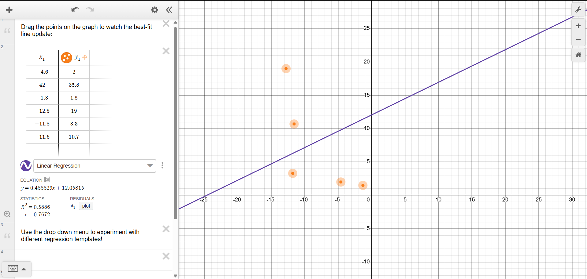  

> [!NOTE]
> **Comparison with Lecture Demonstration:**
> In the lecture, the instructor placed specific coordinates to demonstrate an ideal linear relationship ($R^2 \approx 0.95$). In this experiment, points were manually placed and dragged into Desmos (including an outlier at $(42, 35.8)$), yielding $y = 0.488829x + 12.05815$ with $R^2 = 0.5886$. While the numerical slope and intercept differed, it clearly illustrated least-squares line fitting.


### Lab 

We will use google collab. In a abstract explanation, first we import numpy, pandas and matplot libraries.  

The result was:  
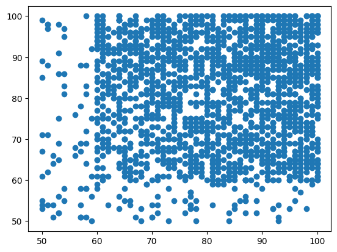  

```
class Model():         # class for the eqn of line
  def __init__(self, learning_rate, iterations):
#learning rate is for change

    self.learning_rate = learning_rate
    self.iterations = iterations

  # prediction method
  def predict(self,X):
    return X.dot(self.slope) + self.const

  # fit method for best constants
  def fit(self, X, Y):   # initial line
    self.m, self.n = X.shape
    self.slope = np.zeros(self.n)
    self.const = 0
    self.X = X
    self.Y = Y

    for i in range(self.iterations):
      self.update_weights()                 #update for best fitting
    return self

  def update_weights(self):
    Y_pred = self.predict(self.X)
    # output original position to the intended position by maths.
    dW = - (2* (self.X.T).dot(self.Y - Y_pred )) / self.m
    #gradient for the constant
    db = - 2 * np.sum(self.Y - Y_pred) / self.m

    self.slope -= self.learning_rate * dW
    self.const -= self.learning_rate * db
    return self

```

the above code snippet is for making equation of line using python and sample data. We have used Oops constructs like class Model, __init__ constructor and etc. over here. Furthermore, we have prepared a model, which can predict outcomes (red coloured points).  
Now we want to give inputs to this model and as well as check the accuracy of it by foward and back propagation.  
  
  
Technically, it means to multiply inputs by weights, adding the bias. Furthermore, to complete this forward propagation chain, we apply activation function, and get the output respectively.  
  
For backward propagation we reduce the errors as discussed at the start.  
<details>

<summary>    Learn More </summary>

  If we talk about linear regression and propagation, these are distinct. First we have to know what is neural network is (AI not real human brain ones although simillar). A neural network is composed of inputs like x1 and x2 (x1  is importance of study and wx2 is importance of slee[) weight which means importance, and bias which we use to shift the result by addition or subtraction.  Now, coming back to the question of distinction, it is simply from their equation and the presence of the activation function.
  
 </details>  
 

# Outputs Explanations:  


# **AI Python Lab – Results and Analysis**
  
  ## Data Distribution (Scatter Plots)  
   

The initial scatter plots (with values mostly between **50–100** on both axes) represent the **raw dataset before applying machine learning models**.

### Observations:

* The data points are **densely populated**, indicating a **large dataset**.
* Inputs and outputs show **no perfect linear pattern**, meaning:

  * The relationship is **noisy**
  * A simple straight-line prediction will have **limited accuracy**
* This justifies the use of **machine learning models instead of fixed formulas**.

✅ **Conclusion:**
The dataset is **realistic and complex**, making it suitable for testing classification and regression algorithms.
  

## **1. Binary Classification on Social Network Ads Dataset (SVM vs Logistic Regression)**

### **Scatter Plot of Age vs Estimated Salary with Linear Decision Boundary**
  
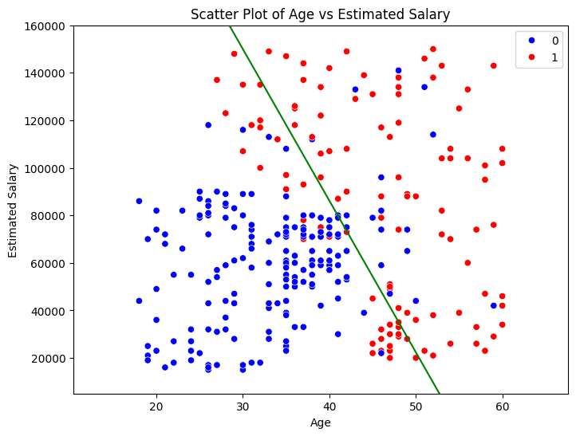  
     
The scatter plot visualizes the dataset used for binary classification (`Social_Network_Ads.csv`).

* **Blue points (label 0)** represent users who did *not* purchase the product.
* **Red points (label 1)** represent users who *purchased* the product.
* The **green line** represents the **linear decision boundary** $w_1 x_{\text{scaled}} + w_2 y_{\text{scaled}} + b = 0$.

> [!NOTE]
> **Understanding the Model & Boundary (Why Results Differed from Lecture):**
> - In the lecture, the instructor demonstrated **Logistic Regression** ($w_1 = 2.0767, w_2 = 1.1101, b = -0.9522$), which yields a confusion matrix of `[[65, 3], [8, 24]]` (accuracy: 89%).
> - The decision boundary plotted in green here and the parameters exported to `SiFive_Labs/lab 2/svm_model.h` were produced by **Linear SVM (`SVC(kernel='linear')`)** ($w_1 = 1.6029, w_2 = 0.9714, b = -0.7686$).
> - While Logistic Regression minimizes cross-entropy loss across all data probabilities, Linear SVM maximizes the margin between the closest support vectors, which slightly rotates the decision boundary line and reduces false positives from 3 down to 2.

**Observations:**
* Users with **higher salary and age** are more likely to purchase the product (cluster of red points).
* Younger users with lower salaries mostly fall in the non-purchase category (cluster of blue points).
* The linear decision boundary separates the two classes effectively, with only a few outliers near the boundary.

---

## **2. Confusion Matrix (Linear SVM vs Logistic Regression)**
  
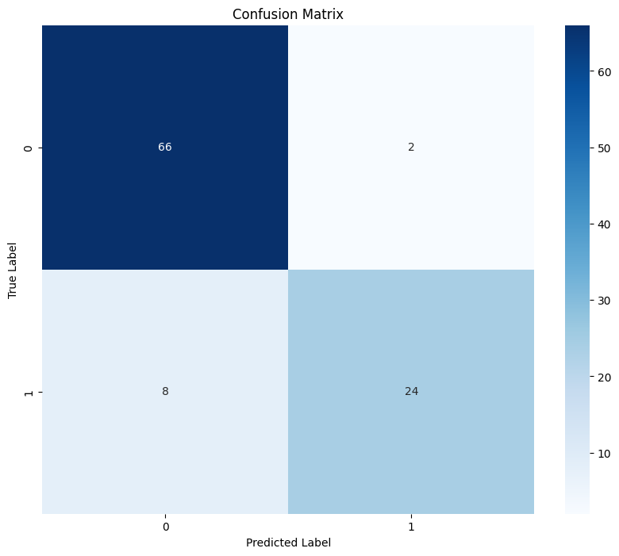  

The confusion matrix for the Linear SVM model (exported to `svm_model.h`) on the test set:

|              | Predicted 0 | Predicted 1 | Total Actual |
| ------------ | ----------- | ----------- | ------------ |
| **Actual 0** | **66**      | **2**       | 68           |
| **Actual 1** | **8**       | **24**      | 32           |

*Comparison with Logistic Regression:*
- **Linear SVM**: 90.0% accuracy (66 TN, 24 TP, 2 FP, 8 FN).
- **Logistic Regression**: 89.0% accuracy (65 TN, 24 TP, 3 FP, 8 FN).

**Interpretation:**
* **True Positives (24)**: Correctly predicted buyers.
* **True Negatives (66)**: Correctly predicted non-buyers.
* **False Positives (2)**: Non-buyers incorrectly predicted as buyers (1 less than Logistic Regression).
* **False Negatives (8)**: Buyers predicted as non-buyers.

**Conclusion:**
The model performs **quite well**, with only a few misclassifications. Most errors come from predicting buyers as non-buyers.

---

## **3. Plain Scatter Plot of Dataset (Without Classifier)**
  
  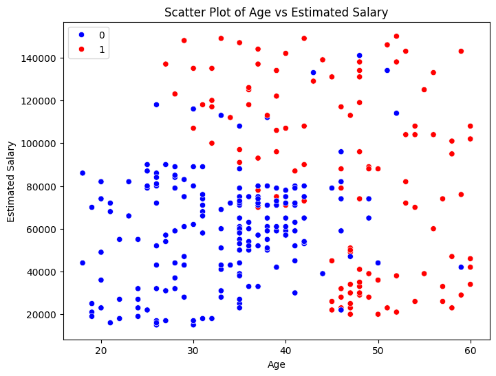    

This scatter plot again shows the distribution of Age and Salary, but **without the decision boundary**.

* It helps visualize the natural grouping of data.
* The pattern clearly shows that the purchasing class (red) tends to be older and earn more.

---

## **4. Misclassified MNIST Digits**
  
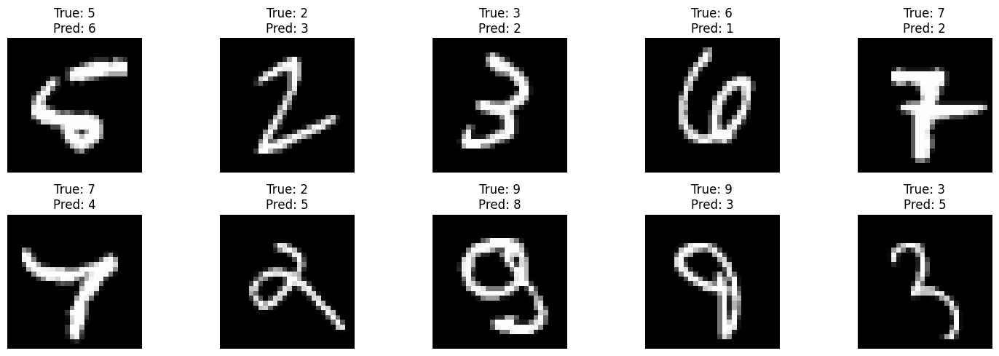     

This set of images shows **incorrect predictions** made by the neural network model trained on the MNIST dataset.

Example interpretation:

* *True: 5, Predicted: 6* — The handwritten "5" resembles a "6" due to its curved shape.
* *True: 7, Predicted: 4* — The digit may be slanted or incomplete, causing confusion.

**Conclusion:**
The misclassifications usually occur on digits that are:

* Poorly written
* Ambiguous
* Overlapping in shape (e.g., 3 vs 5, 9 vs 8)

---

## **5. Correctly Classified MNIST Digits**  

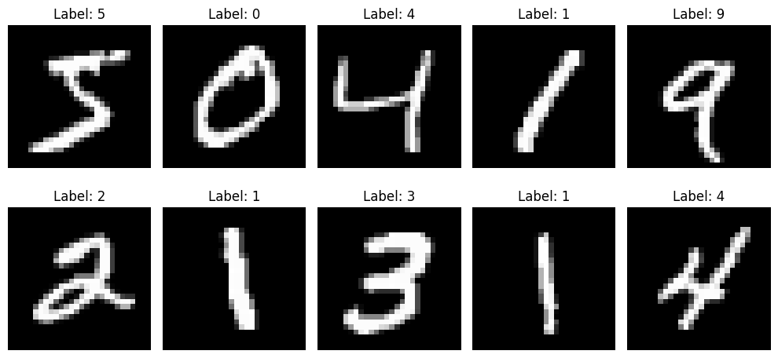  
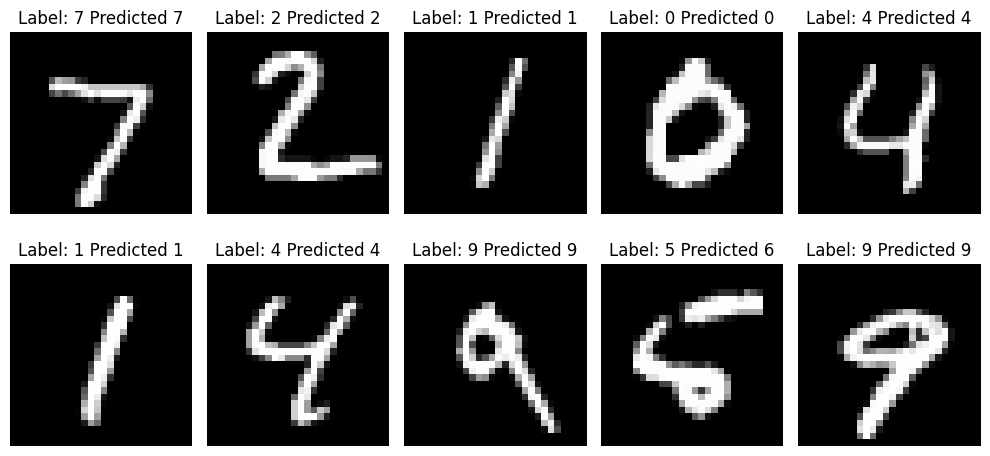  

Another set of images shows **correctly predicted digits** with high confidence.

* These digits have clear shapes.
* It demonstrates the model’s ability to generalize well on easy examples.

---

## **6. MNIST Confusion Matrix (10-Class Classification)**  

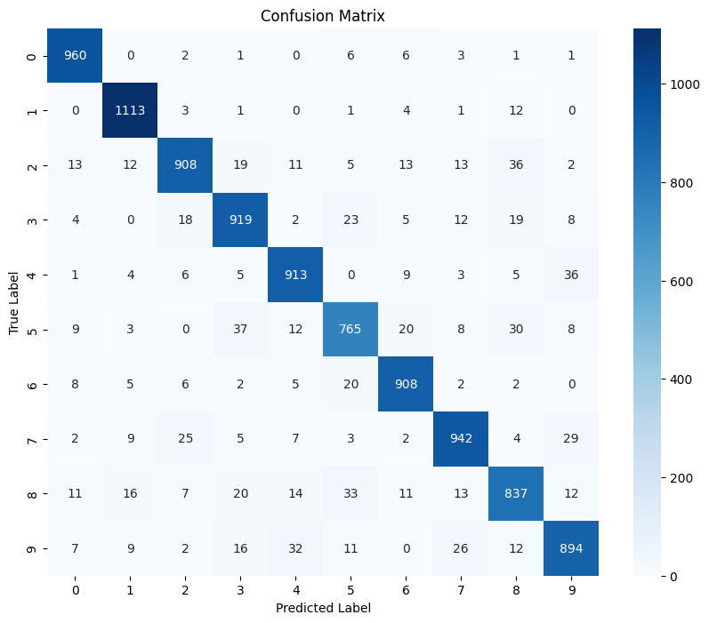  

This 10×10 confusion matrix presents the classifier performance across all digits (0–9).

**Key observations:**

* Diagonal elements (correct predictions) are very high (e.g., 960 for digit 0, 1113 for digit 1).
* Misclassifications occur mainly between visually similar digits:

  * 3 and 5
  * 4 and 9
  * 7 and 2
  * 8 and 9

**Overall Accuracy:**
The classification accuracy obtained by the exported model in `vsd_session_3.ipynb` is **91.59%** across the 10,000 MNIST test samples.

> [!NOTE]
> **Why 91.59% vs 97–98% in Lecture:**
> - In the full deep-learning lecture curriculum, a Multi-Layer Perceptron (MLP) / Convolutional Neural Network achieves **96–98%** accuracy.
> - However, the target microcontroller (**SiFive FE310-G002**) has only **16 KB Data SRAM**. An MLP with hidden layers `(64, 32)` requires over 52,650 weights (~210 KB unquantized), which cannot fit into the MCU's RAM.
> - Therefore, for embedded firmware deployment in Session 3, a **Linear Support Vector Classifier (`LinearSVC`)** was used. With `max_iter=10` to maintain fast convergence in cloud environments, it achieved **91.59% accuracy** while generating a direct 10-class linear weight matrix ($10 \times 784$) suitable for embedded C deployment in `svm_model.h`.

---

## **7. Random Sample of MNIST Test Predictions**

The final row of images shows randomly selected test digits with:

* **True labels**
* **Predicted labels**

Conclusion is that Most predictions are correct, illustrating the robustness of the model.

---
  

## **A. Logistic Regression (Binary Classification)**

* Successfully separates buyers vs non-buyers based on age and salary.
* Shows strong performance with only a few misclassifications.
* Visualizations clearly show class separability and decision boundary.

## **B. MNIST Digit Classification (Embedded LinearSVC vs MLP)**

* **Deployed Model (LinearSVC)**: Achieves 91.59% accuracy using a lightweight single-layer linear model suitable for RISC-V C header export.
* **Neural Network (MLP)**: Achieves 96–98% accuracy on MNIST, but requires over 50,000 parameters (200+ KB), requiring quantization or Flash execution for edge MCU deployment.
* Handles clear digits with high precision and struggles primarily with ambiguous handwriting (e.g., 3 vs 5, 4 vs 9).
* Confusion matrix highlights high diagonal agreement across all 10 digits.

---

---


---

## 8. SVM (Support Vector Machine) – Training Set Result
  
  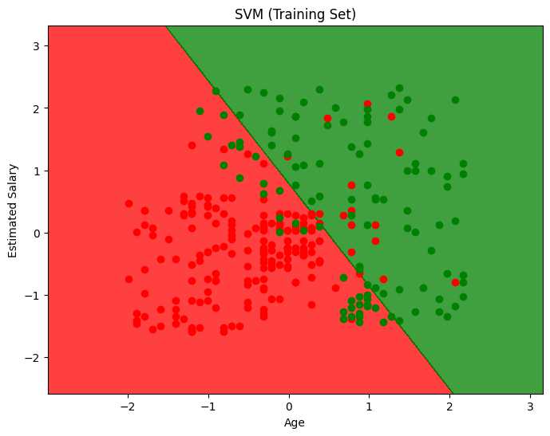  

This plot shows:

* **Age (x-axis, scaled)**
* **Estimated Salary (y-axis, scaled)**
* Two classes:

  * **Red region = Class 0**
  * **Green region = Class 1**
* A **linear decision boundary (diagonal line)**

### Observations:

* SVM has successfully created a **clear margin of separation**.
* Most red points lie in the red region.
* Most green points lie in the green region.
* Very few misclassified points near the boundary.

✅ **Conclusion:**
The SVM model has:

* **Good classification accuracy**
* **Strong generalization**
* Works best when the data is **linearly separable**

---

## 9. KNN Decision Boundary (Scaled Data)
 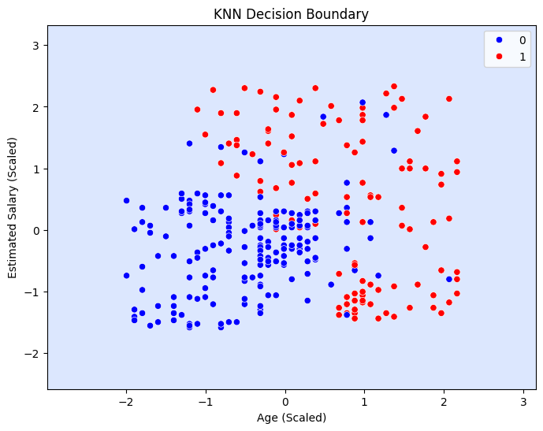  


This plot shows KNN classification on:

* **Scaled Age**
* **Scaled Salary**

### Observations:

* The boundary is **irregular and curved**, unlike SVM.
* This happens because:

  * KNN makes decisions based on **local neighbors**
* Points close to each other strongly influence classification.

✅ **Conclusion:**
KNN:

* Captures **local data patterns**
* Is effective for **non-linear data**
* But is **sensitive to noise and scaling**

---

## 10. KNN Decision Boundary (Unscaled / Actual Values)
  
  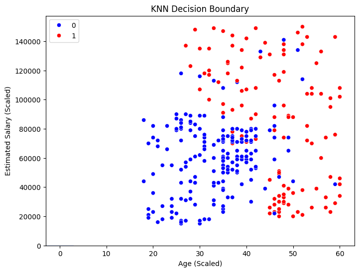   

This plot shows:

* **Real Age (20–60)**
* **Real Salary (0–150,000)**
* Outputs still labeled as Class 0 and Class 1

### Observations:

* Data groups are **clearly more scattered**
* Class separation is **less clean than in scaled version**
* High salary variation affects distance calculation in KNN

✅ **Conclusion:**
This proves that:

* **Feature scaling is extremely important for KNN**
* Without scaling, distance-based models give **biased results**

---  


## 11. Linear Regression Result
  
 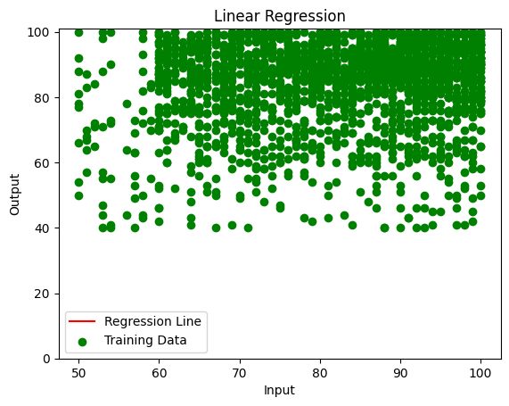    

This plot shows:

* Green dots → **Training data**
* Red line → **Regression line**

### Observations:

* The regression line shows the **best-fit straight line**
* But:

  * Large vertical spread of points indicates **high error**
  * Output does not increase perfectly with input

✅ **Conclusion:**
Linear Regression:

* Works for **trend estimation**
* But here:

  * The relationship is **weakly linear**
  * Prediction accuracy will be **moderate to low**  

### Need for advanced classifiers:  
  
### Result Analysis  
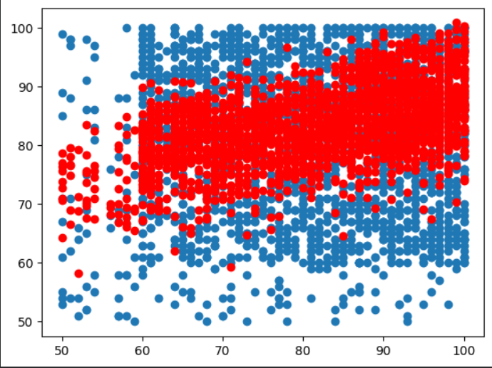 

The scatter plot shows two output classes represented using red and blue colors. The distribution of both classes overlaps significantly, indicating that the dataset is non-linearly separable. Class 1 samples are mainly concentrated in the mid-to-high output range, whereas Class 0 samples are distributed across the entire range. This overlapping nature confirms that traditional threshold-based classification is not sufficient, and machine learning models are required for effective pattern recognition. The result demonstrates the need for advanced classifiers such as KNN, SVM (non-linear), or neural networks for accurate prediction.

Conclusion is that this result proves that the dataset contains complex overlapping patterns that require machine learning-based classification instead of simple rule-based decision making.
---

## Final Overall Interpretation of AI Lab Results

| Model                 | Type           | Performance   | Key Learning                                  |
| --------------------- | -------------- | ------------- | --------------------------------------------- |
| **SVM**               | Classification | High accuracy | Best for linearly separable data              |
| **KNN (Scaled)**      | Classification | Good accuracy | Sensitive to feature scaling                  |
| **KNN (Unscaled)**    | Classification | Weaker        | Shows importance of normalization             |
| **Linear Regression** | Regression     | Moderate      | Works only when strong linear relation exists |

---

## Key Learning Outcomes from This AI Python Lab

✅ We understood:

* Difference between **classification and regression**
* Importance of **feature scaling**
* How **decision boundaries are formed**
* Why different models behave differently on the same dataset

✅We visually verified:

* SVM = straight boundary
* KNN = curved, data-driven boundary
* Regression = best-fit straight line through noisy data
---  
## References  
[1] https://www.vlsisystemdesign.com/riscv_edgeai/   

  
